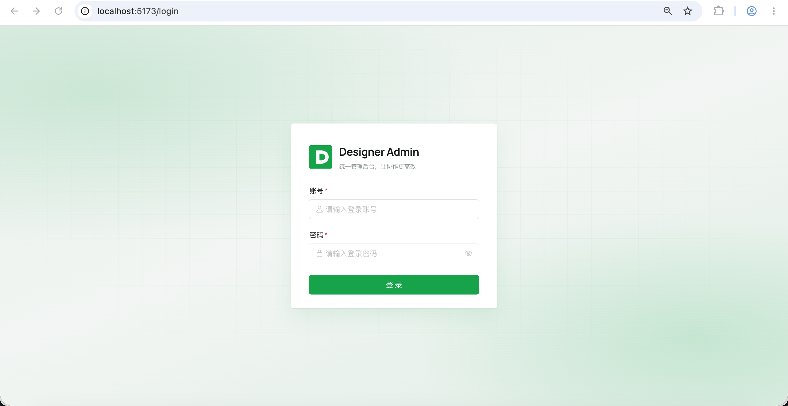
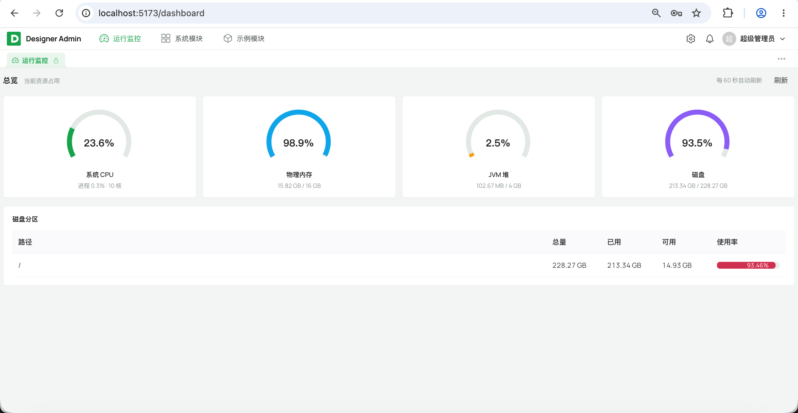
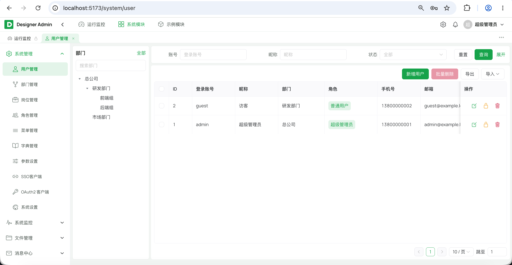
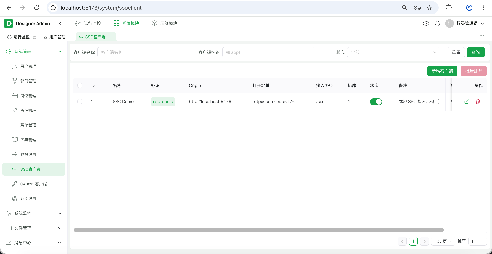
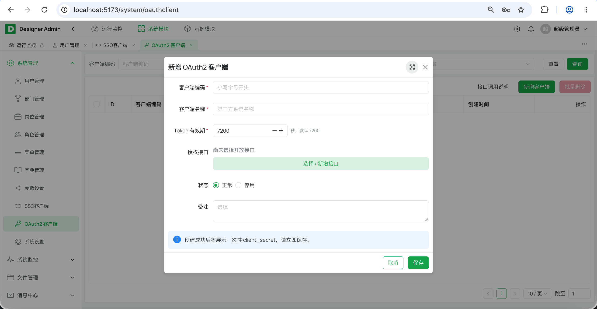
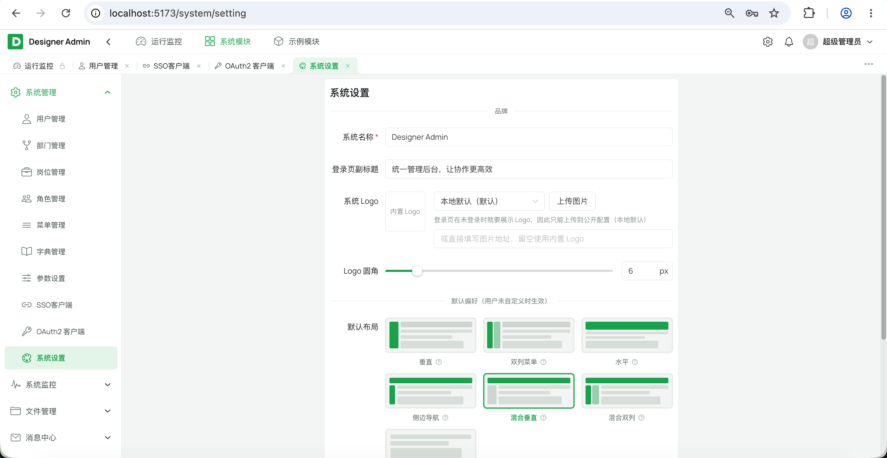
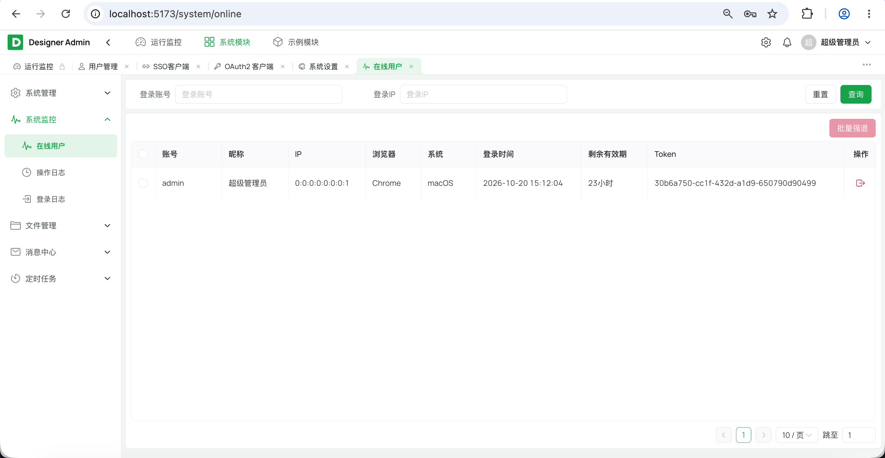
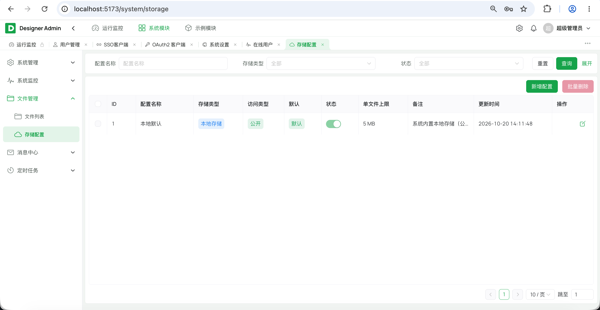
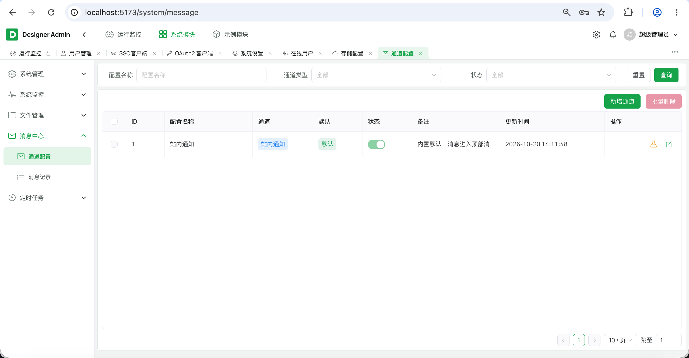
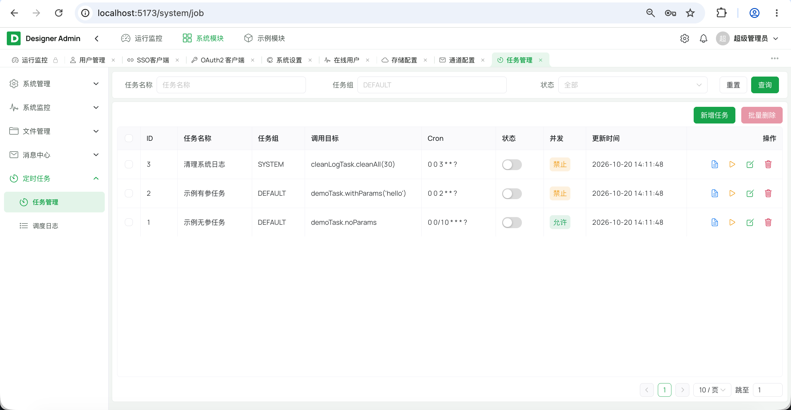

# 后台管理系统脚手架

[](LICENSE)
[](https://adoptium.net/temurin/releases/)
[](https://solon.noear.org/)
[](https://vuejs.org/)

## 简介

一套面向企业后台的**模块化单体脚手架**：后端 Solon + MyBatis-Plus，前端 Vue 3 + Naive UI + Vite，内置登录、RBAC、数据权限、SSO、OAuth2、文件、消息、定时任务与系统设置等基础能力，克隆后即可开始业务开发。

设计上坚持两条原则：

- **简洁、可复用**：用最少的代码完成灵活的功能——相同逻辑不重复写，收敛为公共能力（统一响应、分页、异常、日志、缓存、限流、文件与消息），业务模块只写差异部分；可变项不写死在代码里，能靠配置（`app.yml`、数据库配置、注解参数）调整的就不改代码。
- **易扩展、可维护**：模块之间只依赖对方 `*-api`，框架层通过 SPI 反向解耦；新增业务模块复制模板即可，不需要改脚手架核心。文件存储、消息通道、消息队列同样面向接口扩展，新增实现只需注册为组件、按 `type` 自动装配，调用方无需改动。

### 为什么选择 Solon

- **启动快、资源占用低**：内核轻量，没有 Servlet 容器嵌套，`java -jar` 直接运行，适合单机与容器化部署。
- **包体积小**：依赖精简，最终产出一个可执行的 fat jar；部署时只需 JRE，不需要额外容器。
- **配置简单**：一个 `app.yml` 管完端口、数据源、Redis、Sa-Token、Quartz、日志等，环境变量可直接覆盖。
- **插件化生态**：MyBatis-Plus、Sa-Token、Quartz、Knife4j 等都有 Solon 插件，能力齐全且装配简单。
- **贴合现代 JDK**：项目基于 JDK 25，已开启虚拟线程，I/O 旁路任务不再占用平台线程。

> 需要新增业务模块时，复制 `designer-module-demo`（后端）与 `designer-ui/admin-web/src/modules/demo`（前端），按 [开发规范](docs/开发规范.md) 改包名即可。

## 界面预览





















## 内置能力

| 能力 | 说明 |
|---|---|
| 登录 | Sa-Token 会话、滑块验证码、失败锁定、登录限流 |
| RBAC | 用户 - 角色 - 菜单三级权限，按钮级权限标识 |
| 数据权限 | 角色维度行级数据范围，MyBatis 拦截器自动改写 SQL |
| SSO | 一次性票据跨应用免二次登录 |
| OAuth2 | Client Credentials + Scope 的开放接口 |
| 文件管理 | 本地 / S3 可插拔存储，上传校验、图片压缩、元数据落库、私有下载 |
| 消息管理 | 站内信、邮件通道配置与发送记录 |
| 消息推送 | SSE 实时站内信，多实例经消息总线广播 |
| 定时任务 | Quartz JDBC 集群调度，动态 cron、执行日志 |
| 系统设置 | 系统名称、Logo、默认布局与主题色 |

### 登录

- 基于 **Sa-Token**，token 放在 `Authorization` 请求头（本项目约定不带 `Bearer` 前缀），会话存 Redis，可多实例共享。
- 登录失败达到阈值后触发 **AJ-Captcha 滑块验证码**；验证码凭据一次性、AES 加密传输，失败计数与锁定状态存 Redis。
- 锁定维度：**账号 + IP** 组合锁定，另按 IP 累计失败拦截「一个密码试很多账号」的密码喷洒；账号维度只用于决定是否出验证码。
- **IP 不可伪造**：锁定用的客户端 IP 统一由 `TrustedProxyHostUtil` 解析——对端 socket IP 不在可信代理网段时直接采用 socket IP 并**忽略所有转发头**；只有来自可信代理（默认回环 + Docker 网桥，可用 `designer.client-ip.trusted-proxies` 收窄）的请求，才沿 `X-Forwarded-For` 从右往左取第一个不可信地址。客户端伪造的转发头既不被采信，也无法换出一个新的锁定桶；取不到来源时该请求不参与 IP 锁定，避免所有无 IP 请求共用一个兜底键而被刷到阈值、误锁他人。
- 登录接口额外加 `@RateLimit`（默认 10 次/分钟 + 100 次/24 小时，按 IP），与验证码、账号锁定形成三层防护。
- 支持在线用户查看、单个 / 批量踢下线；登录日志记录账号、IP、浏览器、系统与结果。

### RBAC

- 用户 - 角色 - 菜单三级模型：`sys_user` / `sys_role` / `sys_menu`，关联表为 `sys_user_role`、`sys_role_menu`。
- 菜单分**目录 / 菜单 / 按钮**三类；按钮即权限标识（如 `system:user:add`），后端 `@SaCheckPermission`，前端 `v-perm` 指令。
- 登录后通过 `/admin-api/system/auth/routers` 拉取菜单树，前端据此动态注册路由与侧栏；隐藏页（`visible=0`）注册路由但不进菜单。
- 组织能力包含部门树、岗位（`sys_post` + `sys_user_post`），角色可分配菜单权限与数据权限。
- 超级管理员拥有全部权限，并受保护逻辑约束，避免被误删或降权。

### 数据权限

- 配置在**角色**上：`sys_role.data_scope` 支持「全部 / 自定义部门 / 本部门 / 本部门及以下 / 仅本人」五档；自定义部门存 `sys_role_dept`。多角色取并集，超管不受限。
- 过滤由 **MyBatis 拦截器自动完成**（`AutoDataScopeHandler` + `LazyHandlerDataPermissionInterceptor`），SELECT / UPDATE / DELETE 以及连表、子查询、分页 count 都会被改写，业务代码不写 `dept_id IN (...)`。
- 约定优于配置：表有 `dept_id` 按部门过滤；没有 `dept_id` 但有 `create_by` 时，通过「创建人反查用户部门」表达部门范围。`create_by` 由 `AutoFillHandler` 插入时自动填充，业务表不加字段也能享受数据权限。
- 权限快照存 Redis（`perm:user:{userId}`），写角色 / 菜单 / 用户角色关系后在**事务提交后**主动失效；TTL 仅作兜底。
- 写入侧的越权校验由 `DataPermissionGuard#canSeeDept` 承担（`INSERT` 没有 WHERE，拦截器管不到）；确需绕开时使用 `DataPermissionContext.ignore(...)` 或 `@InterceptorIgnore(dataPermission = "true")`，并明确理由。
- 两个选型边界：反查部门按「创建人**当前**部门」解释；需要「数据归属创建时部门」的业务（合同、凭证等）必须给表加 `dept_id`。

### SSO

- 跨应用免二次登录：已登录后台签发**一次性票据**，客户端拿票据换回同一登录态。
- 票据存 Redis，默认 60 秒过期（`designer.sso.ticket-ttl` 可配），用后即删。
- 后台维护 SSO 客户端白名单（标识、允许 Origin、打开地址、接入路径，`sys_sso_client`）；带 `redirect` 登录时只校验 Origin，不校验具体路径。
- 换票接口：`POST /admin-api/system/auth/sso/exchange`；签发接口：`POST /admin-api/system/auth/sso/ticket`。
- 可运行示例见 [designer-ui/sso-demo](designer-ui/sso-demo)，完整流程见 [docs/SSO.md](docs/SSO.md)。

### OAuth2

- 面向第三方系统的开放接口，采用 **Client Credentials** 模式。
- 令牌端点：`POST /open-api/oauth2/token`，支持 `client_id` / `client_secret` 表单参数或 Basic Auth；返回 RFC 6749 JSON（不包统一 `Result`）。
- `/open-api/**` 按路径匹配 Scope（`sys_oauth_scope`）校验 `access_token`；缺少授权 Scope 返回 403。
- 后台可管理 OAuth2 客户端、重置密钥、维护开放 Scope（`sys_oauth_client` / `sys_oauth_client_scope`）。
- 后端 8080 不直接对外，第三方统一经 Nginx 的 `/open-api/` 前缀访问。

### 文件管理

- 存储方式可插拔：内置**本地磁盘**与 **S3 兼容**（MinIO、OSS、COS 等）实现，实现类通过 `type()` / `configFields()` 自描述，前端据此动态渲染配置表单。
- 上传元数据落 `sys_file`，存储配置落 `sys_storage_config`，后台可切换默认存储、配置公开 / 私有访问。
- 上传校验：扩展名白名单推导 Content-Type（不采信客户端声明）、大小限制、路径穿越双重校验。
- **图片压缩**：开关在**系统管理 → 存储配置 → 编辑 →「图片压缩」**，按配置在服务端落盘前压缩，所有走 `FileStorageService#store` 的入口统一生效（不必在每个上传点单独处理）。

  | 格式 | 行为 |
  |---|---|
  | JPEG | 有损重编码，质量参数生效（10–100） |
  | PNG | 无损重编码，质量参数无效（固定最高 deflate 级别） |
  | GIF / WebP / AVIF / SVG / ICO | 跳过：动图重编码只剩第一帧，其余 JDK ImageIO 不支持编码 |

  压缩后体积更大或压缩失败时降级保留原文件，不阻断上传。
- **图片缓存**：文件名含 UUID、内容不会被原地覆盖，公开文件 `Cache-Control: public, max-age=31536000, immutable`，私有文件 `private, no-store`。代理下载接口与 S3 直链（上传时写入对象元数据）共用 `StorageCachePolicy`，避免两条链路缓存策略分叉。
- 下载：私有文件需登录（`/admin-api/system/file/download/**`），公开文件免登录（`/app-api/system/file/download/**`）；私有下载用 Path 限定的 HttpOnly Cookie，避免放开全局 Cookie 鉴权。
- 响应增加 `X-Content-Type-Options: nosniff` 与 CSP sandbox，前端用 `AttachmentUploader` 复用上传、回显与删除。

### 消息管理

- 消息通道可插拔：内置**站内信**与**邮件**（SMTP）通道，新增短信、钉钉、微信、飞书只需实现 `MessageChannelProvider` 并注册为 Solon 组件。
- 通道配置存 `sys_message_config`，发送记录存 `sys_message_record`；后台支持新增 / 编辑 / 测试发送。
- 配置字段由 Provider 的 `configFields()` 声明，前端动态渲染，不需要为每种通道单独写页面。
- SMTP 密码、存储 AccessKey / SecretKey 等敏感配置可用 `VAULT_PASSWORD` 做主密钥 AES 加密后落库（`ENC(...)`），未配置时保持明文兼容历史数据。

### 消息推送

- 站内信通过 **SSE** 实时推送：`/admin-api/system/notice/sse`，支持未读数、全部已读、消息中心入口。
- 单实例内存维护连接；多实例通过 `NoticeSseHub` 订阅消息总线主题，发送方只 `publish` 一次，消息能到达浏览器实际连接的那台节点。
- SSE 连接有定时心跳，避免中间代理因空闲断开；前端 `store/notice.js` 负责建连、重连与红点状态。
- SSE 端点的 token 通过专用 Filter（`SseQueryTokenFilter`）从 query 提升为请求头，只匹配该路径，不放开全局 query / Cookie 鉴权。

### 定时任务

- 基于 **Quartz JDBC JobStore + 集群模式**：调度状态落 `QRTZ_*` 表，多实例靠数据库行锁协调，同一任务不会被重复执行。
- `sys_job` 保存业务定义（任务名、cron、调用目标、启停、并发策略），`QRTZ_*` 保存运行时状态；应用启动时由 `SysJobServiceImpl` 对账。
- 支持 cron 表达式、调用目标（bean.method）、并发 / 禁止并发两种执行策略，执行结果写 `sys_job_log`。
- 任务基类 `AbstractQuartzJob` 统一处理执行前后钩子、耗时统计与异常日志；日志异步落库，不阻塞任务线程。
- 调度器线程池默认 10 个线程，可在 `app.yml` 的 `org.quartz.threadPool.threadCount` 调整。

### 系统设置

- 单行配置表 `sys_setting`（固定 `id=1`），维护系统名称、登录页副标题、Logo（含圆角）、默认布局与默认主题色。
- 公开接口 `GET /admin-api/system/setting/public` 免登录，登录页在拿到 token 前即可展示系统名称与 Logo。
- 前端浏览器标题、侧栏 / 顶栏名称、favicon 都跟随系统设置；未自定义偏好时使用系统默认布局与主题色。
- 布局与主题色按维度分别判断：用户改过布局不会覆盖系统默认主题色，反之亦然。

## 设计

### 技术栈选择

| 层 | 选型 | 版本 | 选择理由 |
|---|---|---|---|
| 运行时 | JDK | 25 | 使用虚拟线程、record 等现代特性 |
| 后端框架 | Solon | 4.1.0 | 轻量、启动快、配置简单、插件化 |
| ORM | MyBatis-Plus | 3.5.17 | 单表 CRUD 省样板代码，逻辑删除 / 自动填充开箱即用 |
| 多表查询 | MyBatis-Plus-Join | 1.5.9 | 连表避免手写 XML，仍保留 SQL 可控性 |
| 鉴权 | Sa-Token | 1.46.0 | 登录、权限、会话、踢人一套解决，Redis 插件成熟 |
| 密码哈希 | BCrypt（at.favre.lib） | 0.10.2 | Sa-Token 1.41 起不再维护加密模块，独立实现更稳 |
| JSON | snack4 | Solon 4.x 内置 | 与 Solon 渲染链一致，少一个依赖 |
| 定时任务 | Quartz | 2.5.0 | JDBC JobStore + 集群，满足多实例调度 |
| 消息总线 | 自研 `MessageBus` SPI | — | 默认 Redis Pub/Sub，可替换 RabbitMQ 等 |
| 导入导出 | EasyExcel | 4.0.3 | 流式读写，内存占用可控 |
| 数据库 | MySQL | 8.0.13+ | 通用、运维成本低；表结构依赖 8.0.13 起支持的函数索引 |
| 缓存 / 会话 | Redis | 7 | 会话、权限快照、限流、验证码、Pub/Sub 共用 |
| 前端框架 | Vue | 3.5 | 组合式 API，模块边界清晰 |
| UI 组件库 | Naive UI | 2.45 | 主题变量完善，适合做统一外观 |
| 构建 | Vite | 8 | 冷启动与 HMR 快；生产构建 minify 并预生成 `.gz` |
| 状态管理 | Pinia | 4 | 轻量、TypeScript 友好 |
| 路由 | Vue Router | 5.3 | 动态路由与守卫能力完整 |
| 图表 | ECharts | 5.6 | 仪表盘与统计图 |

### 开发规范

完整约定见 [docs/开发规范.md](docs/开发规范.md)。编码风格以工具可校验的规则为准：

- **后端遵循《阿里巴巴 Java 开发手册》**：根 `pom.xml` 集成 PMD + P3C 规则集（命名、常量、注释、OOP、并发、异常、集合、流程控制、ORM），执行 `mvn pmd:pmd` 生成扫描报告。
- **前端使用 ESLint**：扁平配置（`eslint.config.js`），基于 `@eslint/js` + `eslint-plugin-vue` 的 `flat/essential`，`pnpm run lint` 检查、`pnpm run lint:fix` 自动修复；只查正确性，不强制格式（不接 Prettier）。

### 部署脚本

`deploy/` 下提供一套“本机打包 + Docker 运行”的脚本，数据库与应用分开部署：

| 脚本 | 作用 |
|---|---|
| `install-env.sh` | 检查 / 安装 Docker、JDK 25、Maven、Node.js（`--check` 仅检查） |
| `deploy-db.sh` | 启动 MySQL + Redis（不自动建表） |
| `deploy-app.sh` | 本地 Maven + 前端打包，构建运行镜像并启动 Server / Web |
| `deploy-minio.sh` | 可选，启动本地 MinIO（S3 兼容存储） |
| `stop.sh` / `restart.sh` / `logs.sh` | 停止、重启、查看日志 |

生产环境建议：

- 后端容器只绑定 `127.0.0.1:8080`，所有流量经 Nginx 转发，避免绕过代理伪造 IP。
- Nginx 覆写（而不是追加）`X-Forwarded-For`，丢弃客户端伪造链。
- 后端与应用容器均非 root 运行，日志与上传目录使用数据卷。
- 通过 `.env` 注入数据库、Redis、JVM 参数、`VAULT_PASSWORD` 与接口文档开关。

### 文档说明

| 文档 | 说明 |
|---|---|
| [docs/开发规范.md](docs/开发规范.md) | 前后端编码约定、模块依赖方向、新增业务模块步骤 |
| [docs/SSO.md](docs/SSO.md) | 单点登录流程与三步接入指引 |
| [deploy/](deploy) | Docker 部署脚本与 Nginx / Dockerfile 配置（用法见下方「生产部署」） |
| [designer-module-demo](designer-module-demo) | 业务模块模板源码（复制后改包名即可开启新模块） |
| [designer-ui/sso-demo/README.md](designer-ui/sso-demo/README.md) | SSO 客户端示例工程 |

### 后台设计考虑

#### 分层结构

```
designer-admin/
├── designer-common/                # 通用契约：Result / PageQuery / BaseEntity / 异常 / 工具 / 注解
├── designer-framework/             # 技术能力与 SPI：鉴权、限流、验证码、日志、任务、存储、消息、MyBatis
├── designer-module-system/
│   ├── system-api/                 # 跨模块契约：*Api 及 Api 自用类型
│   └── system-service/             # RBAC、认证、文件、消息、任务、监控等实现
├── designer-module-demo/           # 业务模块模板（demo-api / demo-service）
├── designer-server/                # 唯一启动组装：DesignerApp + app.yml + 胖包
├── designer-ui/                    # 前端：admin-web、sso-demo、shared/captcha
├── sql/init/mysql/                 # 按模块组织的初始化 SQL
├── deploy/                         # Docker 部署脚本与配置
└── docs/                           # 开发规范、SSO 等文档
```

一次请求的典型路径：

```
Controller（参数校验 / 权限注解 / 限流）
    → Service 接口 + Impl（事务 / 缓存 / 业务规则）
        → Mapper（MyBatis-Plus / MPJ，数据权限拦截器自动改写）
            → MySQL
```

跨模块调用只走 `*Api`：`*-service` 在 `api` 包实现 `*ApiImpl`，由它完成 Api 类型与内部 entity / DTO / VO 的转换。这样模块可以独立演进，也避免把内部模型暴露出去。

#### 设计模式

| 模式 | 落地位置 | 作用 |
|---|---|---|
| 策略 + 注册表 | `FileStorageProvider` / `MessageChannelProvider` + Registry | 存储、消息通道按 `type` 装配，新增实现不改核心流程 |
| 工厂 / 选择器 | `MessageBusManager` | 按 `designer.mq.type` 选定消息总线实现，配错启动即失败 |
| 模板方法 | `AbstractQuartzJob` | 固定“执行前 → 执行 → 执行后记日志”骨架，子类只写任务体 |
| 拦截器 / 责任链 | `GlobalExceptionFilter`、`OperLogInterceptor`、`RateLimitInterceptor`、MyBatis 数据权限拦截器 | 横切能力与业务解耦，按顺序生效 |
| 依赖倒置 | `PermissionLoader`、`OperLogWriter`、`MessageRecordWriter`、`JobLogWriter`、`MessageConfigSource`、`StorageConfigSource`、`InboxSink` | `framework` 定义接口，`system-service` 提供实现，框架不反向依赖业务 |
| 门面 | `FileStorageService`、`MessageService` | 对外隐藏配置解析、Provider 选择、记录落库等细节 |
| 建造者 | `StoredFile.builder()` | 文件元数据字段多，构建过程更清晰 |

#### 参数验证

- Controller 类标注 `@Valid`，请求体参数用 `@Body @Validated`，配合 `@NotBlank`、`@Length`、`@Email` 等约束注解。
- `GlobalExceptionFilter` 捕获 `ValidatorException`，统一返回 `{code: 400, msg: "参数校验失败：..."}`，不把堆栈暴露给调用方。
- 分页参数由 `PageQuery` 统一处理：页码小于 1 归一到 1，`pageSize` 最大 500，避免恶意大分页。
- 文件上传按扩展名白名单推导类型，校验大小与路径；不采信客户端声明的 `Content-Type`。
- 注意：Solon 的参数校验由 Filter 执行，没有写约束的字段等于没有校验，不能指望 `@Valid` 自动兜底。

#### 日志记录

- 使用 Solon 内置 Logback 集成，`logback-solon.xml` 定义三路输出：
  - `CONSOLE`：控制台；
  - `FILE`：全量文件（INFO 及以上）；
  - `ERROR_FILE`：仅 ERROR，默认文件名加 `-error` 后缀。
- 文件按「天 + 单文件大小」滚动，默认单文件 10 MB、保留 7 天、总量上限 1 GB，均可通过 `solon.logging.appender.*` 调整。
- 操作日志：`@OperLog` 由 `OperLogInterceptor` 环绕，记录标题、业务类型、方法、URL、IP、操作人、参数、结果、耗时与异常；写入异步化，失败不影响主流程。
- 登录日志（`sys_login_log`）与任务日志（`sys_job_log`）独立落库，便于审计与排障。
- 未知异常只在服务端记录详细堆栈，响应统一为“系统繁忙，请稍后重试”，避免泄露 SQL、类名、路径等内部信息。

#### 事务管理

- 写操作在 Service 实现层使用 Solon `@Transaction`，事务边界保持在数据库写操作附近，避免长事务。
- 日志、消息记录等旁路写入通过 `RunUtil.asyncAndTry` 异步执行，不占用事务时间。
- 权限快照失效挂在 `TranUtils.listen(...).afterCommit()`：事务内解析受影响用户，提交后再删缓存；回滚时不删，保证缓存与数据库一致。
- 注意 Solon 的 `@Transaction`、`@Cache`、`@RateLimit` 都依赖代理，**同一个 bean 内部 `this.xxx()` 自调用不会生效**；需要横切能力时把方法放到另一个 bean，或从外部入口调用。

#### 缓存管理

- 声明式缓存使用 `@Cache` / `@CacheRemove`，由 `RedisCacheService` 落到 Redis，多实例共享；Redis 异常时 fail-open（读当未命中、写只记日志），不回源失败放大成接口 500。
- 只缓存「读多写少 + 与调用者无关」的公共数据：字典、下拉选项、启用的 Scope / 白名单、系统设置公开信息等；分页与关键字查询不加缓存。
- 键名与 tag 统一收敛在 `SystemCacheConsts`；`key = "...:#{dictType}"` 依赖 `-parameters` 编译，参数改名会导致缓存键求值异常。
- 权限快照单独用 Redis 管理（`perm:user:{userId}`），TTL 默认 600 秒；正常失效靠写侧主动删键，TTL 只覆盖直连改库等绕过应用的变更。
- 缓存键统一加前缀（`cache:` / `perm:` / `rate:` 等），便于排查与批量清理。

#### 线程池管理

- `solon.threads.virtual.enabled: true`：Solon 的并行 / 调度执行器使用虚拟线程，日志落库、消息发送、SSE 分发等 I/O 旁路任务不再占用平台线程。
- 旁路任务统一用 `RunUtil.asyncAndTry(...)`，异常被吞掉并记录，不影响主流程；SSE 心跳用 `RunUtil.scheduleAtFixedRate`。
- Quartz 使用独立线程池（`org.quartz.threadPool.threadCount`，默认 10），与 Web 请求线程隔离。
- 数据库连接池使用 HikariCP（`maximumPoolSize: 10`，`minimumIdle: 2`），连接超时、空闲回收、最大生命周期均在 `app.yml` 配置。
- 当前没有为业务单独拆 CPU 密集型线程池；如果新增批量计算、报表导出等重任务，建议单独定义执行器并加队列 / 拒绝策略与监控，避免挤占 Web 与调度线程。

#### 接口限流

- 声明式注解 `@RateLimit` 可标在 Controller 类或方法上，支持多条规则（如“30 秒 1 次 + 每天 20 次”），规则按声明顺序校验。
- 维度支持 `IP` / `USER` / `GLOBAL` / `HEADER`；未登录的 `USER` 维度自动退化为 IP，避免所有匿名请求共用一个桶。
- **IP 维度防伪造**：计数主体由 `ClientIpUtil` 统一归一化（与落库的登录 / 操作日志同一个值），底层取自 `TrustedProxyHostUtil` 的可信解析——不可信对端只认 socket IP，可信代理才允许携带转发头。因此伪造 `X-Forwarded-For` / `X-Real-IP` 换不来新的限流桶；Nginx 侧同时**覆写**（而非追加）转发头，形成应用与代理两层防线。
- 底层是 Redis 固定窗口计数（Lua 原子操作），多实例阈值不会被放大成「实例数 × 阈值」；限流键包含 `count x window`，改阈值等于换新桶。
- 拦截器 `index = -1`，位于校验、缓存、事务之前，被限的请求不会白开事务、白查缓存。
- Redis 未装配或维度取不到值时 fail-open 并打日志：限流是保护手段，不应把业务接口变成 500。
- Nginx 侧对验证码等入口另配 `limit_req`，超限返回 429，与应用层限流语义一致。

#### 消息队列

- `MessageBus` SPI 提供 `publish` / `subscribe`，订阅返回可关闭的 `Subscription`；默认实现为 **Redis Pub/Sub**，另有进程内 `local` 实现用于单机调试。
- `MessageBusManager` 按 `designer.mq.type` 选择实现，启动时校验配置；配置写错直接失败并列出可用实现，避免静默退化成单机。
- Redis Pub/Sub 不持久化、不补发，适合站内信这类实时广播；需要可靠投递时新增实现（如 RabbitMQ / Kafka）并标注 `@Component` 即可接入。
- 当前主要用途是 SSE 跨实例广播：每个实例订阅同一主题，发送方只发布一次，消息到达浏览器实际连接的节点。
- 多套环境共用 Redis 时必须使用不同主题名（Pub/Sub 不区分 database index），否则消息会串环境。

#### 升级 SQL 脚本管理

- **初始化脚本**：`sql/init/mysql/` 按模块组织，`00-run-init.sh` 按 `_base → system → demo` 顺序导入；新增业务模块时增加同名目录并把模块名加入脚本的 `MODULES`。
- 初始化脚本是**破坏性**的（`DROP TABLE` 重建 + 插入种子数据），只用于首次初始化或本地重置，**禁止对有数据的生产库重复执行**。
- **版本要求**：`schema.sql` 用函数索引 `(IF(deleted = 0, 0, NULL))` 在逻辑删除下维持唯一约束，依赖 **MySQL 8.0.13+**；更低版本或 MariaDB 需改为虚拟生成列 + 普通唯一索引。
- **增量升级**：约定放在 `sql/upgrade/mysql/`，按 `V{版本}__{说明}.sql` 命名，版本单调递增、只追加不修改历史脚本；发布时按版本顺序执行并登记执行结果。
- 当前仓库尚未内置 Flyway / Liquibase 自动迁移，增量脚本需人工评审与执行；后续接入时建议把现有 `schema.sql` 作为 baseline，再把升级脚本纳入 CI 校验。
- 无论是否使用迁移工具，生产变更都要求：先备份、再执行、可回滚，并在发布记录中登记版本号。

#### 接口文档

- 使用 OpenAPI2 + Knife4j，启动后访问 `http://localhost:8080/doc.html`。
- `DocConfig` 按包扫描分为三组：管理端接口、前台接口、开放接口；只有同时标注 `@Api` 与 `@ApiOperation` 的接口才会出现在文档中。
- 统一声明 `Result` 响应体与 200 / 400 / 401 / 403 / 500 状态码说明，减少每个接口重复描述。
- 生产环境建议通过 `KNIFE4J_ENABLE=false` 关闭文档；如需保留，至少设置 `KNIFE4J_PRODUCTION=true`，并限制为内网访问。

### 前端设计考虑

#### 分层结构

前端按「壳层 → 业务模块 → 公共能力」三层组织，依赖只能自上而下，业务模块之间互不引用：

```
designer-ui/admin-web/src/
├── layout/               # 布局壳：Sidebar / Navbar / TagsView / MessageInbox / PreferenceSettings
├── views/                # 壳层页面：login / dashboard / profile / error
├── router/               # 常量路由 + 动态路由注册（按菜单树解析 modules/*/views）
├── store/                # Pinia：user（token / 权限 / 路由）、app（偏好）、setting（系统设置）、notice（站内信）
├── api/                  # 壳层接口：request 实例、auth、captcha、monitor
├── modules/              # 业务模块，按模块隔离
│   ├── system/           # 系统管理：api/ + views/<域>/index.vue
│   └── demo/             # 示例模块：api/ + views/
├── components/           # 全局通用组件（PageTable / SearchBar / Dialog …）
├── composables/          # 可复用逻辑 useXxx()
├── directives/           # 全局指令（v-perm）
├── theme/ · styles/      # 主题色派生、Naive UI overrides、全局 CSS 变量
├── constants/ · utils/   # 常量与工具函数
└── App.vue · main.js · settings.js
```

各层职责：

| 层 | 目录 | 职责 | 约束 |
|---|---|---|---|
| 壳层 | `layout/`、`views/`、`router/`、`store/`、`api/` | 登录页、布局、导航、页签、动态路由、全局状态与请求封装 | 只承载框架级能力，不放业务逻辑 |
| 业务层 | `modules/<module>/` | 该模块的 `api/` 与 `views/`，必要时自建 `components/`、`utils/` | 只引用 `@/api`、`@/components`、`@/composables` 等公共层，**不引用其他模块** |
| 公共层 | `components/`、`composables/`、`utils/`、`constants/`、`theme/`、`styles/` | 与业务无关的组件、组合式函数、工具、常量、主题 | 不得反向依赖 `modules/` 或 `views/` |

一次请求与渲染的典型路径：

```
views / modules 页面
    → usePagination / useFormDialog（状态与分页）
        → modules/<module>/api（按模块组织的接口函数）
            → @/api/request（axios 实例：token、统一响应、401 / 429）
                → /admin-api（Nginx / Vite 代理）
```

关键约定：

- **业务代码只进 `modules/<module>/`**，不往 `views/` / `api/` 壳层塞业务页面，保证壳层可随脚手架统一升级。
- **模块之间不互相 import**：需要跨模块数据时走各自 `api/` 调后端接口，或提升为 `components/` / `composables/` 公共能力。
- **路由不需要手写**：菜单 `component` 填 `{module}/{path}`，`router/index.js` 用 `import.meta.glob('../modules/*/views/**/*.vue')` 解析，新增页面只加目录与菜单记录。
- **新增业务模块**：复制 `modules/demo` → `modules/foo`，在菜单里填 `foo/index` 即可，不需要改路由或壳层代码。

#### 公共布局

- 布局壳在 `src/layout/`：侧栏、顶栏、页签（`TagsView`）、消息中心、偏好设置统一收口，业务页面只关心内容区。
- 内置 **7 种布局**：垂直、双列菜单、水平、侧边导航、混合垂直、混合双列、内容全屏，可在偏好设置中实时切换并持久化。
- 动态路由：常量路由写在 `router/index.js`，登录后按后端菜单树注册；菜单 `component` 字符串按 `{module}/{path}` 解析到 `src/modules/{module}/views/{path}.vue`。
- 权限指令 `v-perm="'system:user:add'"` 无权限时直接移除元素；路由守卫负责登录态、用户信息与菜单加载。
- 请求统一走 `@/api/request`：自动带 `Authorization`，统一处理 `{code,msg,data}`、401 跳登录、429 限流提示与 FormData 边界。

#### 公共组件

| 组件 | 作用 |
|---|---|
| `SearchBar` | 搜索区容器，自动绑定查询 / 重置 / 展开，操作按钮对齐 |
| `PageTable` | 基于 `n-data-table`，自动绑定分页、勾选、加载态、空状态与横向滚动 |
| `PaginationBar` | 统一分页条，页码 / 每页条数双向绑定 |
| `Dialog` | 统一弹框，支持尺寸、全屏、拖拽、页脚按钮与提交 loading |
| `DetailDrawer` | 详情抽屉，适合只读信息展示 |
| `AttachmentUploader` | 附件上传、回显、删除，复用后端文件接口 |
| `TableToolbar` / `TableEmpty` | 表格工具栏与统一空状态 |
| `UserPickerDialog` / `IconPicker` / `LayoutPicker` / `ThemeColorPicker` | 选人、图标、布局、主题色等业务通用选择器 |

配套组合式函数：

- `usePagination(fetcher)`：查询条件、分页、加载态、勾选、排序、重置一次搞定，返回值可直接传给 `SearchBar` 与 `PageTable`。
- `useFormDialog()`：新增 / 编辑弹框状态机，表单校验通过后自动关闭。
- `useBatchDelete()` / `useConfirmAction()` / `useActionLock()`：批量删除、二次确认、按钮防重复点击。
- `useDict()`：字典数据加载与缓存；`useClientSort()`：前端排序。

一个典型 CRUD 页面由 `SearchBar` + `PageTable` + `Dialog` + `usePagination` + `useFormDialog` 拼装，业务代码只保留字段、接口与校验规则。

#### 外观和布局方便修改

- 主题色由 `src/theme/index.js` 从单一主色派生完整色板（hover / pressed / light / suppl），同时生成 Naive UI `themeOverrides` 与 CSS 变量。
- 全局样式统一使用 `--color-primary`、`--color-surface`、`--color-border`、`--radius` 等变量，业务页面不写死颜色与圆角。
- 偏好设置支持主题色、布局、页签、侧栏等切换并持久化；未自定义时回退到「系统设置」下发的默认布局与默认主题色。
- 品牌信息（系统名称、Logo、Logo 圆角、favicon）由系统设置驱动，换品牌不需要改代码。
- 新增外观维度时，优先在 `theme/` 与 `styles/index.css` 增加变量，再由组件消费，避免逐页调样式。

#### 构建压缩

生产产物在**构建期**完成压缩，运行时 nginx 只负责挑合适的文件下发，不在请求路径上现压。

| 环节 | 做法 | 说明 |
|---|---|---|
| JS / CSS 内容压缩 | `vite.config.js` 显式 `build.minify: 'oxc'`、`build.cssMinify: true` | 去掉换行与多余空格；写死配置避免被改成 `false` 导致体积翻倍 |
| `index.html` | `plugins/compressAssets.js` 的 `minifyHtml` | Vite 默认不压 HTML；插件去注释、折叠空白，并单独压缩内联脚本 |
| gzip 预压缩 | 同插件的 `compressAssets`，对 `dist/**` 生成同名 `.gz`（`gzip -9`） | 只压文本类扩展名；小于 1KB 或压完反而变大的跳过 |
| 下发 | nginx `gzip_static on` + `gzip on`（见 `deploy/nginx/default.conf`） | 优先下发构建好的 `.gz`，找不到再回落现压；`gzip_vary on` 让代理按 `Accept-Encoding` 分缓存 |

- `compressAssets` 在 `closeBundle` 执行，等 `public/` 也复制进 `dist/` 之后再扫，一次构建覆盖全部静态资源。
- `.gz` 是构建产物，不要手动创建或提交（`dist/` 已在 `.gitignore`）；本地 `vite preview` 也会命中预压缩文件，无需额外配置。

## 快速开始（本地开发）

### 0. 环境要求

| 组件 | 版本 | 说明 |
|---|---|---|
| JDK | 25+ | 后端编译与运行（`maven.compiler.release=25`） |
| Maven | 3.9+ | 后端构建 |
| Node.js | 18+（推荐 22） | 前端构建 |
| pnpm | 10.x | 前端包管理（`packageManager: pnpm@10.33.0`） |
| MySQL | 8.0.13+ | 数据库 |
| Redis | 7 | 会话、缓存、限流、验证码、消息总线（**必需**） |

> MySQL 最低 **8.0.13**：唯一约束用函数索引 `UNIQUE KEY (业务键, (IF(deleted = 0, 0, NULL)))` 实现「逻辑删除后可重建同名记录」（`deleted = 1` 时表达式为 `NULL`，不占用唯一值），该语法 8.0.13 才引入，低版本会报语法错误，MariaDB 不支持。

一键检查 / 安装环境：

```bash
cd deploy
./install-env.sh --check   # 仅检查
./install-env.sh           # 按需安装（Linux 建议 sudo）
```

### 1. 准备 MySQL 与 Redis

连接信息在 `designer-server/src/main/resources/app.yml`，支持环境变量覆盖：

- MySQL：`DB_HOST` / `DB_PORT` / `DB_USER` / `DB_PASSWORD` / `DB_NAME`
- Redis：`REDIS_HOST` / `REDIS_PORT` / `REDIS_PASSWORD` / `REDIS_DB`

本地也可以用 Docker 只起数据库：

```bash
cd deploy
cp .env.example .env
./deploy-db.sh        # MySQL + Redis，不自动建表
```

### 2. 初始化数据库

> 脚本为**破坏性初始化**（`DROP TABLE` 重建 + 插入种子数据），仅首次或需要重置时执行，勿对有数据的库重复运行。

```bash
# 交互式：按提示输入连接信息，回车使用默认值
bash sql/init/mysql/00-run-init.sh

# 免交互（CI / 脚本）
DB_HOST=127.0.0.1 DB_PORT=3306 DB_USER=root DB_PASSWORD=root DB_NAME=designer_agent \
  bash sql/init/mysql/00-run-init.sh
```

默认数据库名为 `designer_agent`，可在交互中或通过 `DB_NAME` 自定义。

### 3. 启动后端

在 IDE 中运行 `com.designer.admin.DesignerApp`（模块 `designer-server`），或命令行：

```bash
# 仓库根目录
mvn -pl designer-server -am -DskipTests clean package
java -jar designer-server/target/designer-server.jar
```

启动后：

- 管理端 API：`http://localhost:8080/admin-api`
- 健康检查：`GET http://localhost:8080/admin-api/system/health`
- 接口文档：`http://localhost:8080/doc.html`
- 示例接口：`GET http://localhost:8080/admin-api/demo/ping`（需登录）

### 4. 启动前端

```bash
# 需要 pnpm：corepack enable pnpm 或 npm i -g pnpm
cd designer-ui/admin-web
pnpm install
pnpm run dev      # http://localhost:5173
pnpm run build    # 产出 dist/
```

开发环境已配置 Vite 代理，`/admin-api`、`/app-api`、`/open-api` 均转发到 `http://localhost:8080`。

### 默认账号

| 账号 | 密码 | 角色 |
|---|---|---|
| admin | admin123 | 超级管理员（全部权限） |
| guest | guest123 | 普通用户（只读示例） |

> 以上为种子数据中的演示账号，**部署到生产环境前必须修改密码或删除**。

## 生产部署

数据库与应用**分开部署**：本机用 JDK / Maven / Node 打包，再构建运行镜像；MySQL、Redis 与应用容器分离。

### 部署流程

```bash
cd deploy

# 1. 检查并按需安装环境（Docker / JDK 25 / Maven / Node）
./install-env.sh

# 2. 配置环境变量
cp .env.example .env
vim .env

# 3. 启动 MySQL + Redis（不自动建表）
./deploy-db.sh

# 4. 首次 / 重置时初始化数据库
(cd .. && bash sql/init/mysql/00-run-init.sh)

# 5. 本地打包 + 构建镜像 + 启动 Server / Web
./deploy-app.sh
```

可选：`./deploy-minio.sh` 启动本地 MinIO（S3 兼容存储，API `9000` / Console `9001`）。

使用外部数据库时，只需配置 `.env` 中的 `DB_*` / `REDIS_*` 后执行 `./deploy-app.sh`；建表仍通过 `sql/init/mysql/00-run-init.sh`（支持交互输入，也可用环境变量免交互）。

### 常用命令

| 命令 | 说明 |
|---|---|
| `./install-env.sh` | 检查并安装环境（`--check` 仅检查） |
| `./deploy-db.sh` | 启动 MySQL、Redis（不自动建表） |
| `./deploy-minio.sh` | 启动本地 MinIO（可选） |
| `./deploy-app.sh` | 本地打包并部署应用 |
| `./deploy-app.sh --skip-build` | 跳过打包，复用 `deploy/build` 已有产物 |
| `./restart.sh app` / `./stop.sh app` | 重启 / 停止应用 |
| `./logs.sh server` | 查看后端容器标准输出日志 |

### 访问入口

| 入口 | 默认端口 | 说明 |
|---|---|---|
| 管理后台 | `APP_PORT=80` | 浏览器访问 `http://<服务器IP>` |
| 后端 API | `SERVER_PORT=8080` | 仅绑定 `127.0.0.1`，不直接对外，统一经 Nginx |
| 接口文档 | `SERVER_PORT` | 生产环境建议 `KNIFE4J_ENABLE=false` 关闭 |

### 日志

- **文件日志**：容器内 `/app/logs/designer-server.log`（全量）与 `/app/logs/designer-server-error.log`（仅 ERROR），挂载在 `server_logs` 卷；按「天 + 单文件 10 MB」滚动，默认保留 7 天、总量上限 1 GB。
- **容器 stdout**：`./logs.sh server` 看到的是 Docker 收集的标准输出，由 compose 的 `logging.options` 限制大小（`max-size=50m` / `max-file=5`）。
- **调整策略**：改 `solon.logging.appender.file.*`（或 `error.*` 单独覆盖），或用环境变量 `LOG_PATH` 更换日志路径。

### 发布与运维

- 日常发版只执行 `./deploy-app.sh`，不必动数据库；`--skip-build` 可复用已有打包产物。
- 数据库表需手动初始化；增量升级 SQL 按版本执行并登记，禁止重跑破坏性的初始化脚本。
- 上传文件在 `server_uploads` 卷，升级 / 迁移时需与数据库一起备份。
- 修改 `.env` 中的默认密码、`VAULT_PASSWORD`，并为 MySQL / Redis 配置强密码；本机库时 `DB_PASSWORD` 与 `MYSQL_ROOT_PASSWORD` 保持一致。
- 多实例部署时：Sa-Token 会话、权限快照、限流、验证码、消息总线共用 Redis；Quartz 共用同一套 `QRTZ_*` 表；各实例 `org.quartz.scheduler.instanceId` 必须不同。
- 反向代理不在默认可信网段（回环 + `172.16.0.0/12`）内时，必须通过 `designer.client-ip.trusted-proxies` 补上，否则后端会把代理自身地址当成客户端 IP，导致登录锁定与 IP 限流全部挤在同一个桶里；该网段也不宜过宽，否则网段内地址可以互相伪装。
- 健康检查：`GET /admin-api/system/health`；Nginx 侧 `/health` 已转发到该接口。

## 许可证

本项目基于 [MIT License](LICENSE) 开源，可自由用于商业项目。
